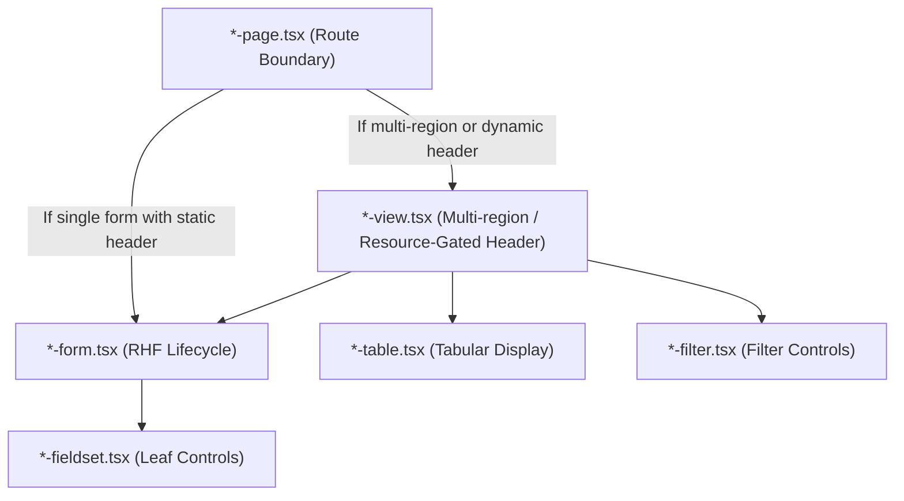
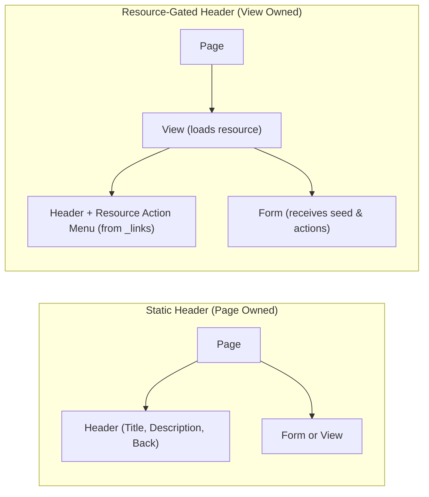

# Screen Layers & Responsibilities

This document defines the component hierarchy and layer ownership: `Page → View → Form / Table / Filter → Fieldsets`.

This is a **responsibility split**, not a mandatory number of wrappers. Skip a layer whenever it would be a simple pass-through.

---

## 1. The Screen Layers



### Page (`*-page.tsx`)
A `*-page.tsx` is the route boundary. It owns:
- Route parameter parsing and validation guards (`useParams`).
- Page container layout and page-scoped providers (`SlotProvider`, `PlatformProvider`).
- Shell breadcrumbs (`useShellBreadcrumb`).
- Feature-root capability discovery (`useRoot`, `useCatalogLink`, `useInventoryLink`) to determine if the screen or action is available.
- Mapping typed child lifecycle events to shell toasts, breadcrumbs, or navigation.

> [!CAUTION]
> A page MUST NOT contain field-level form state, request DTO mapping, domain tables, resource summaries, or fieldsets.

### View (`*-view.tsx`)
Introduce a `*-view.tsx` only when it coordinates a meaningful screen region:
- List filter + create action + table.
- Detail summary + action forms/tables.
- Parent summary + child list.
- Wizard or multi-step workflow.
- **Edit/Detail whose `Header` requires actions from loaded resource `_links`**.

A view MAY own list/filter hooks, the screen's resource query, and loading/error states for that query.
**Do not add a view that only forwards props to a single form.** Create screens stay `page → form`.

### Form (`*-form.tsx`)
- Owns one form lifecycle and its React Hook Form instance (`useForm`).
- Provides `FormProvider` to child fieldsets.
- Coordinates submit handling, dirty state, and extension slot resets.
- Emits typed lifecycle events to its parent.

### Leaf Components (`*-table.tsx`, `*-filter.tsx`, `*-fieldset.tsx`)
- **`*-table.tsx`**: Owns tabular rendering, row actions, loading/empty states, and pagination callbacks.
- **`*-filter.tsx`**: Owns filter input controls; does NOT perform data fetching.
- **`*-fieldset.tsx`**: Owns related input controls and reads typed form context via `useFormContext`.

---

## 2. Header Ownership

`Header` is owned by the **nearest layer that already has the data to render it**:



1. **Page-Owned Header**:
   - Static title, description, back button, and list-level create action.
   - Standard for list screens, create screens, and edit screens where the header does not read resource `_links`.
2. **View-Owned Header**:
   - Resource-gated actions (e.g. `Archive`, `Restore`, `Publish`) when those actions originate from the loaded resource's `_links`.
   - *Reference implementation*: `product-edit-view.tsx` loads the product and composes `Header` with `ProductActionsMenu` and `ProductEditForm`.

> [!WARNING]
> Do NOT portal header controls. Do NOT copy resource `_links` onto the page just to satisfy a header.

---

## 3. Standard Screen Blueprints

### A. List Screen Blueprint
```text
<entity>-list-page
  ├── Header (static chrome, back button, title)
  └── <entity>s-view
      ├── use-<entity>-filter
      ├── <entity>-filter
      └── <entity>-table
          └── use-<entity>s query
```

### B. Create Screen Blueprint (Page → Form)
```text
<entity>-new-page
  ├── resolve create capability link (root or nested parent GET)
  ├── Header / Back action (static chrome)
  ├── QueryState (loading / error / empty)
  ├── lifecycle events → toasts & navigation
  └── <entity>-new-form(link, onLifecycleEvent)
      ├── useForm<FormValues>({ defaultValues, mode: "onSubmit" })
      ├── FormProvider
      ├── fieldsets & extension slots
      └── use-<entity>-create-submit
```

### C. Edit Screen Blueprint (Resource-Gated Header)
```text
<entity>-edit-page
  ├── validate route ID
  ├── root capability check (QueryState)
  ├── SlotProvider
  ├── lifecycle events → toasts, breadcrumbs, navigation
  └── <entity>-edit-view(id, onLifecycleEvent)
      ├── load resource query (seed, actions)
      ├── Header (Back + ProductActionsMenu from actions)
      └── <entity>-edit-form(seed, actions, onLifecycleEvent)
          ├── FormProvider
          ├── fieldsets & extension slots
          └── use-<entity>-update-submit
```
