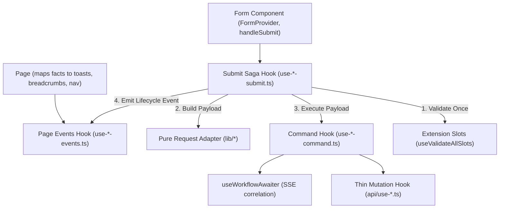

# Form Architecture & Write-Path Taxonomy

This document governs form state, validation, write-path execution layers, and shell context bar integration.

---

## 1. Write-Path Layer Taxonomy

To eliminate monolithic form components and untangled mutation callbacks, complex write operations follow a strict responsibility split:



### Layer Responsibilities

1. **Page Events** (`use-<entity>-<op>-events.ts`):
   - Maps lifecycle facts to `platform.events` (`shell:toast:v1`), breadcrumbs, and navigation.
   - MUST NOT read form state, call HTTP, or validate extension slots.
2. **Submit Saga** (`use-<entity>-<op>-submit.ts`):
   - Coordinates the entire submit use-case.
   - Validates extension slots **once** via `useValidateAllSlots()`.
   - Merges valid contributions via `mergeContributions()`.
   - Calls the pure adapter in `lib/` to build the request DTO.
   - Calls `command.execute(payload)`.
   - Executes secondary operations (media attachment, description updates).
   - Invalidates relevant React Query cache keys.
   - Emits a past-tense lifecycle event.
3. **Command** (`use-<entity>-<op>-command.ts`):
   - Pure **payload in, result out**.
   - Coordinates `useMutation` and `useWorkflowAwaiter`.
   - MUST NOT read `useFormContext`, validate slots, display toasts, or navigate.
4. **Adapter** (`lib/<operation>-<entity>-request.ts`):
   - Pure data mapping function. Zero React dependencies. Fully unit tested.
5. **Field UI** (`ui/*-fieldset.tsx` or module folder):
   - Reads form context via `useFormContext<T>()`.
   - Renders controls using `@khinemyaezin/seller-ui`.

---

## 2. Skip Rules

Do not create unnecessary files for trivial operations:
- **Simple POST** (no extension slots, no workflow await, no secondary attachments): The form or a small submit hook MAY call the TanStack `useMutation` directly. Do not introduce a command file.
- **Complex Write** (extension slots, workflow await, and/or secondary attachments): Use the full submit saga + command + adapter architecture.

---

## 3. Form Validation Rules

1. **React Hook Form**: Always instantiate forms with a typed `useForm<T>()` and typed default values.
2. **Zod Validation**:
   - For internal domain forms, standard RHF rules or Zod schemas are valid.
   - For cross-MFE slot forms, validation MUST adhere to the canonical payload schemas defined in `@khinemyaezin/seller-contracts`.
3. **Validate Once**: The submit saga validates host fields via `handleSubmit`, then executes `await validate()` on all extension slots. If validation fails, fire `validationFailed` and abort immediately.

---

## 4. Shell ContextBar & Dirty State Tracking

Long or composite forms integrate with `useContextBar`:

```tsx
const { handleSubmit, reset, formState: { isDirty } } = useFormContext<ProductFormValue>();
const [isExtensionDirty, resetExtensionDirty] = useIsExtensionDirty();
const resetAllSlots = useResetAllSlots();

useContextBar({
  dirty: isDirty || isExtensionDirty,
  onSave: async () => {
    let valid = false;
    await handleSubmit(
      async () => {
        valid = true;
        await submit();
      },
      () => {
        valid = false;
      },
    )();
    if (!valid) {
      throw new Error("Form validation failed");
    }
  },
  onDiscard: () => {
    resetAllSlots();
    reset(seed);
    resetExtensionDirty();
  },
});
```

### Critical Rules:
- **Composite Dirty State**: Always combine host form dirty state (`isDirty`) with extension slot dirty state (`isExtensionDirty`).
- **Throw on Validation Failure**: `onSave` MUST reject if validation fails to prevent the shell from rendering a false success state.
- **Complete Discard**: `onDiscard` MUST reset the host form, reset all slot handles (`useResetAllSlots`), and clear extension dirty state.
