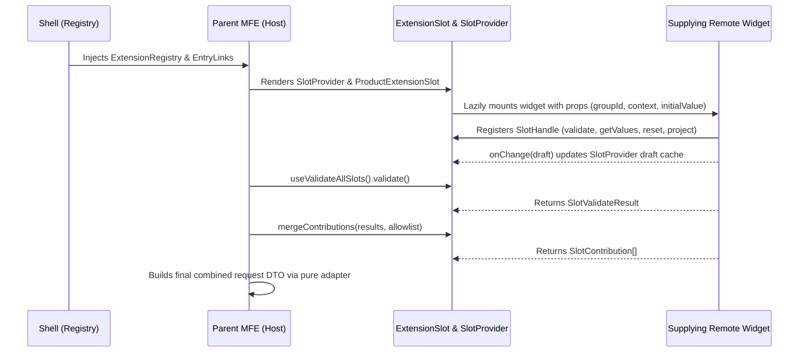

# Extension Slot Architecture & Module Federation Widgets

This document defines the declaration-driven, props-down/handles-up extension slot architecture for cross-MFE UI composition.

---

## 1. Extension Slot Lifecycle & Flow



---

## 2. Architectural Ownership

1. **Shell (`grab-seller`)**:
   - Lazily imports remote widgets via Module Federation.
   - Maps canonical slot names to widgets in the registry.
   - Injects `SellerPlatform` and the supplying domain's entry link.
   - Ensures fault isolation via `RemoteBoundary` / fallback boundaries.
2. **Parent MFE (Consumer)**:
   - Owns slot placement within its pages and forms.
   - Generates and manages stable `groupId`s (e.g. per variant or per form).
   - Passes typed context to the widget.
   - Declares whether slots are required or optional.
   - Enforces an explicit slice allowlist during `mergeContributions`.
   - Assembles the final API request DTO.
3. **Supplying Domain MFE (Provider)**:
   - Exposes the widget entrypoint in `vite.config.ts`.
   - Validates domain payloads against canonical schemas.
   - Owns local field presentation variants (`full` vs `inline`).
   - Implements reset baselines.
   - Projects validated domain values into `SlotContribution[]`.
4. **Shared Packages (`seller-contracts`, `seller-ui`)**:
   - Canonical slot names, context types, payload schemas, and slice definitions.
   - `ExtensionSlot`, `SlotProvider`, draft caches, validation orchestrators, and merge utilities.

---

## 3. The Canonical Slot Contract

Every supplied widget MUST satisfy the `SlotWidgetProps<TContext, TPayload>` interface from `@khinemyaezin/seller-contracts`:

```ts
export type SlotWidgetProps<TContext, TPayload> = {
  groupId: string;
  slotId: string;
  variant?: "full" | "inline";
  context?: TContext;
  initialValue?: TPayload;
  onChange: (value: TPayload) => void;
  registerHandle?: (handle: SlotHandle<TPayload>) => void | (() => void);
};
```

### Core Rules:
- **Stable `groupId`**: Identifies one logical entity instance (e.g., variant row, pricing tier). A new entity must receive a new `groupId`.
- **Variants**: Use `variant?: "full" | "inline"` for layout styling; never create separate slot names just for layout variations.
- **Props Down, Handles Up**: Context flows down via props. Draft values flow up via `onChange`. Capabilities (validation, reset, projection) flow up via `registerHandle`.
- **No Direct Form Nesting**: An embedded slot MUST NOT render an HTML `<form>` tag when placed inside a parent form.
- **Isolation**: Sibling slots MUST NOT communicate directly. All coordination must be mediated by the parent.

---

## 4. Parent Placement Wrapper

The parent MFE wraps the generic `ExtensionSlot` into a domain-specific wrapper (e.g., `ProductExtensionSlot`):

```tsx
export function ProductExtensionSlot<TContext, TPayload>({
  name,
  domain,
  groupId,
  context,
  variant,
  optional,
  fallback,
}: ProductExtensionSlotProps<TContext, TPayload>) {
  const { initialValue, onChange } = useSlotDraft<TPayload>(domain, groupId);
  const errors = useSlotErrors(groupId);
  const message = Object.values(errors)[0];

  return (
    <div className="grid gap-1">
      <ExtensionSlot
        name={name}
        optional={optional}
        variant={variant}
        fallback={fallback}
        props={{ groupId, context, initialValue, onChange }}
      />
      {message ? <p className="text-sm text-destructive">{message}</p> : null}
    </div>
  );
}
```

---

## 5. Validation, Projection & Contribution Merging

On parent form submission:

```ts
const PRODUCT_SLICES = [
  PRODUCT_CONTRIBUTION_SLICES.PRICING_LINES,
  PRODUCT_CONTRIBUTION_SLICES.INVENTORY_LINES,
] as const;

// 1. Validate all registered extension slots
const results = await validate();
const errors = collectSlotFieldErrors(results);
if (results.some((result) => !result.valid)) {
  onLifecycleEvent?.({ type: "validationFailed", errors });
  throw new Error("Validation failed");
}

// 2. Merge contributions using strict slice allowlist
const contributions = mergeContributions(results, PRODUCT_SLICES);

// 3. Assemble final request DTO
const payload = buildCreateSellableProductRequest(formValues, contributions);
```

- Each slot's `project()` returns `{ slice: string; append: unknown[] }`.
- Unknown or non-allowlisted slices throw `UnknownSlotSliceError`.
- Parent components MUST NOT inspect or recreate slot internals.
