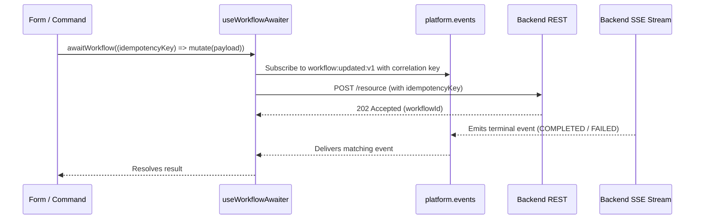

# Events, Messaging & Stream Architecture

This document defines platform event bus communication, backend Server-Sent Events (SSE), and typed component lifecycle signals.

---

## 1. Event Bus Communication (`platform.events`)

Cross-MFE events are mediated through `SellerPlatform.events` (provided via `PlatformProvider` and accessed with `usePlatform()`):

```ts
const platform = usePlatform();

// Emit an event
platform?.events.emit("shell:toast:v1", {
  type: "success",
  message: "Product created successfully",
});

// Subscribe to an event
useEffect(() => {
  if (!platform?.events) return;
  const unsubscribe = platform.events.subscribe("workflow:updated:v1", (payload) => {
    // Handle workflow update
  });
  return () => unsubscribe();
}, [platform?.events]);
```

### Event Naming & Payload Rules:
- **Versioned Naming**: All topics MUST follow `domain:fact:v1` (e.g. `auth:login-success:v1`, `shell:toast:v1`, `workflow:updated:v1`).
- **Contract Enforcement**: All event payloads MUST be defined in `@khinemyaezin/seller-contracts` (`EventPayloads`).
- **Fact Signals, Not State Sync**: Cross-MFE events represent facts that have occurred. Receivers should invalidate local query caches rather than broadcasting full data dumps over the bus.
- **Forbidden Uses**: Do NOT use the event bus for same-tree React prop passing, form bindings, or slot validation/draft synchronization.

---

## 2. Standard Platform Event Topics

| Topic | Publisher | Intended Consumer | Purpose |
|:---|:---|:---|:---|
| `auth:login-success:v1` | `grab-seller-auth` | `grab-seller` (Shell) | Triggers session reload upon authentication |
| `auth:logout:v1` | `grab-seller` | All Remotes | Notifies remotes of session termination |
| `auth:session-refreshed:v1`| `grab-seller` | All Remotes | Notifies remotes that credentials were rotated |
| `shell:toast:v1` | Any Remote | `grab-seller` (Shell) | Requests toast display via `sonner` |
| `shell:breadcrumb:v1` | Any Remote | `grab-seller` (Shell) | Updates shell breadcrumb trail |
| `form:dirty:v1` | Form via `useContextBar`| `grab-seller` | Notifies shell of unsaved changes |
| `form:save:v1` | `grab-seller` (`ContextBar`)| Active Form | Shell command requesting form submission |
| `form:discard:v1` | `grab-seller` (`ContextBar`)| Active Form | Shell command requesting form discard/reset |
| `workflow:updated:v1` | `grab-seller` (SSE Stream)| Domain Remotes | Propagates backend workflow terminal signals |

---

## 3. Host-Owned Backend Event Stream (SSE)

1. **Sole Ownership**: The shell alone owns the authenticated backend SSE stream connection. Remotes MUST NOT open their own stream connections.
2. **Topic Mapping**: The shell translates relevant SSE stream messages into versioned `platform.events` (e.g., `workflow:updated:v1`).
3. **Heartbeat Encapsulation**: Heartbeats are managed internally by the shell stream parser and never emitted over the event bus.
4. **HATEOAS Source of Truth**: Stream events inform remotes that an async workflow progressed; authoritative entity state is always fetched via REST/HATEOAS queries.

---

## 4. Asynchronous Workflow Completion (`useWorkflowAwaiter`)

When an action triggers an asynchronous backend saga:



### Workflow Rules:
1. Generate an `idempotencyKey` **before** the request.
2. Subscribe to the event bus **before** triggering the POST to prevent losing fast terminal events.
3. Correlate using `workflowName` + `idempotencyKey`.
4. Treat `COMPLETED`, `FAILED`, `COMPENSATED`, and timeouts distinctly.
5. Invalidate relevant queries upon confirmed completion.

---

## 5. Typed Lifecycle Events (Component Boundaries)

Children report operational outcomes to parent pages through discriminated unions:

```ts
export type ProductLifecycleEvent =
  | { type: "titleResolved"; title: string }
  | { type: "created"; productId: string }
  | { type: "createFailed" }
  | { type: "createTimedOut" }
  | { type: "updated" }
  | { type: "updateFailed" }
  | { type: "updateTimedOut" }
  | { type: "archived"; name: string }
  | { type: "restored" }
  | { type: "validationFailed"; errors: Record<string, unknown> };
```

- Events represent facts that already occurred (past tense).
- Include the created resource ID on `created` so the parent page can handle navigation.
- Pages map lifecycle events to shell toasts, breadcrumb titles, and routing.
