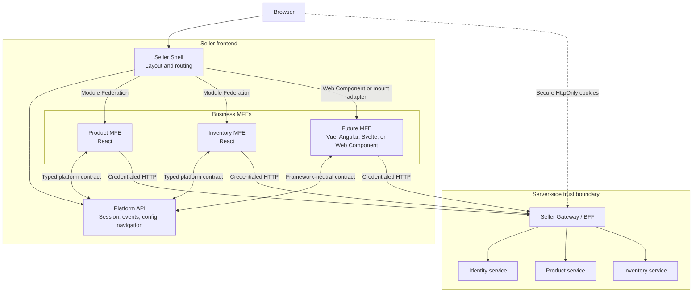
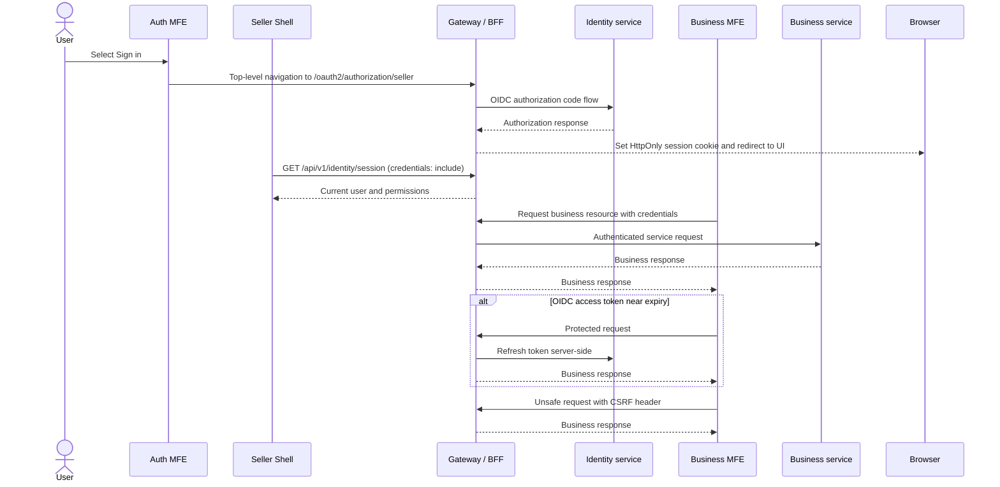

# ADR 001: MFE State, Communication, and Cookie-based Authentication

**Status:** Accepted  
**Date:** 2026-06-21

---

## 1. The Problem

**What's not working?**  
The frontend's former auth flow assumed JSON login and refresh endpoints. The Seller BFF now owns OIDC login, server-side token storage, session refresh, and logout. Unsafe requests also need to follow the BFF's CSRF contract.

**What's at stake?**  
Keeping bearer tokens in browser-readable storage allows an XSS vulnerability in the Shell or any loaded MFE to exfiltrate the token. Without explicit state ownership and communication contracts, MFEs can become tightly coupled through shared stores, framework internals, or unversioned events, making independent deployment unsafe.

---

## 2. What We Decided

**The core approach:**  
Use a Shell-owned, framework-neutral Platform API for global frontend concerns; keep business state within its owning MFE or backend; communicate through explicit inputs and versioned events; and use backend-managed `HttpOnly` authentication cookies instead of exposing JWTs to MFEs.

**Key changes:**

- The Shell owns session state, routing, runtime configuration, layout, theme, and other application-wide concerns.
- Each MFE owns its local UI state and server-state cache. The backend remains the source of truth for business entities.
- Parent-child communication uses explicit inputs and callbacks. Cross-MFE business notifications use versioned, framework-neutral events containing identifiers rather than complete entities.
- React MFEs continue to use Module Federation. Non-React MFEs integrate through Web Components or a `mount`/`unmount` adapter and use the same Platform API contracts.
- The browser authenticates through top-level OIDC navigation to `/oauth2/authorization/seller`. The BFF keeps OAuth tokens server-side and gives the browser an `HttpOnly`, `Secure`, `SameSite=Lax` session cookie.
- MFEs never read, store, publish, or pass raw access or refresh tokens. Requests are sent with credentials, and the Shell obtains the current user from the authenticated profile endpoint.
- The Shell restores the session from `GET /api/v1/identity/session`. The BFF refreshes OIDC tokens server-side as needed; the frontend does not call a JSON refresh endpoint or retry business requests after `401`.
- The shared API client discovers `get-csrf-token` and sends the returned dynamic header on unsafe requests. CSRF tokens stay in memory and are fetched again after a full page navigation.
- Registration remains a JSON request protected by CSRF. On success, the browser follows the discovered OIDC login link.
- Logout posts the discovered logout route through a top-level form, including the CSRF form parameter so the BFF and issuer redirects complete in the browser.
- Authentication and authorization remain backend responsibilities. Frontend route guards improve user experience but are not security controls.

**What stays the same:**  
Product and Inventory remain independently deployable MFEs. The Seller gateway continues to provide same-origin routes for the Shell, remote assets, and `/api/v1`. Business communication with backend services remains HTTP-based, and the backend remains authoritative for permissions and business data.

### State ownership and communication rules

| Concern                                     | Owner                  | Communication mechanism                    |
| ------------------------------------------- | ---------------------- | ------------------------------------------ |
| Form, modal, selection, and table state     | Individual MFE         | Internal framework state                   |
| Product, inventory, and other business data | Backend and owning MFE | HTTP API and MFE-local cache               |
| Authentication status and current user      | Shell                  | Read-only session contract/subscription    |
| OAuth access and refresh tokens             | Seller BFF             | Server-side OIDC session storage           |
| Browser session credential                  | Seller BFF             | `HttpOnly` session cookie                  |
| Current route and shareable filters         | Shell/URL              | Platform navigation API and URL parameters |
| Theme, locale, and runtime configuration    | Shell                  | Read-only Platform API                     |
| Parent-to-child data                        | Composing application  | Props, attributes, or mount parameters     |
| Cross-MFE business changes                  | Producing MFE          | Versioned event with entity identifiers    |

Cross-MFE events announce that something happened; they do not replicate a shared database in the browser. For example, `product.updated.v1` carries a `productId`, and a consumer refetches any data it owns that may have changed.

---

## 2.1. Visual Overview

> _Diagrams to understand the architecture at a glance._

### High-Level Components and Communication

### Authentication Flow

---

## 3. Why This Approach

**Primary reasons:**

1. **Reduced credential exposure:** `HttpOnly` cookies prevent JavaScript from reading and exfiltrating tokens. XSS can still perform actions as the user, so CSP, output encoding, remote integrity controls, and backend authorization remain required.
2. **Framework independence:** The Platform API and event payloads are JavaScript/JSON contracts rather than React Context or a particular state-management library.
3. **Clear ownership:** Local UI state stays local, business data stays backend-owned, and only genuine application-wide concerns live in the Shell.
4. **Independent delivery:** MFEs depend on versioned contracts rather than importing one another or mutating a shared global store.
5. **Backend alignment:** The Seller BFF is the browser OIDC client, keeps OAuth tokens server-side, and protects unsafe routes with CSRF.

---

## 4. Trade-offs

| Pros                                                                   | Cons                                                                                               |
| ---------------------------------------------------------------------- | -------------------------------------------------------------------------------------------------- |
| Raw credentials are unavailable to Shell and MFE JavaScript.           | Cookie authentication requires correct gateway, domain, HTTPS, `SameSite`, and CORS configuration. |
| MFEs no longer inject or exchange bearer tokens.                       | The Shell must call the profile endpoint to restore a session after reload.                        |
| Framework-neutral contracts support React and non-React MFEs.          | Platform and event contracts require ownership, versioning, and compatibility tests.               |
| State ownership prevents a large shared frontend store.                | Consumers may refetch data after an event instead of reusing another MFE's cache.                  |
| Same-origin gateway routing simplifies browser security configuration. | Cookie-based authentication requires CSRF controls appropriate to the selected `SameSite` policy.  |
| Backend-managed refresh centralizes credential lifecycle.              | Unsafe requests need a fresh CSRF token and must follow the BFF's configured origin/cookie policy. |

---

## 5. What Needs to Change

**Implementation:**

- The shared `seller-api` client retains `credentials: "include"`, discovers the BFF CSRF link, and adds its dynamic header to unsafe requests.
- The Shell bootstraps and revalidates the session through the BFF session profile. A `401` marks the user anonymous; a `403` remains an authorization failure.
- The auth MFE starts sign-in with a top-level OIDC link, registers with a CSRF-protected request, and logs out with a CSRF-protected top-level form post.
- API requests do not inject bearer credentials or call a JSON refresh endpoint. Standalone development platforms keep their local mock session behavior.

**Team impact:**

- Frontend teams treat authentication as a session capability and never handle raw tokens.
- MFE teams publish and consume reviewed, versioned event contracts rather than importing other MFEs or sharing mutable stores.
- Backend and platform teams jointly own cookie attributes, CSRF policy, refresh behavior, and gateway authentication translation.
- Deployment validation must cover production HTTPS and local development, where the backend currently uses `Secure=false` and `SameSite=Lax`.

---

## 6. Verification

- Shared API tests cover credentialed reads, dynamic CSRF headers on unsafe methods, token reuse within one page load, and `401` handling without client refresh.
- Auth MFE tests cover OIDC link navigation, registration requests, and logout form submission.
- Shell tests cover profile-based session revalidation, anonymous state on `401`, and preservation of authenticated state on transient failures.
- Deployments must route the configured API base URL and HATEOAS links to the Seller BFF. Production uses HTTPS, secure HttpOnly cookies, Redis-backed sessions, and exact OIDC callback and post-logout URLs.

---

## 7. Related Documents

- [Backend ADR 013: MFE Communication and Authentication](../../../grab/docs/architecture/decisions/ADR-013-authentication-cookie-session.md)
- [Backend Feature: Identity Cookie Generation](../../../grab/docs/features/FAT-0007_identity-cookie-generation.md)
- [Seller ADR authoring prompt](ADR-prompt.md)
- [Current Shell authentication context](../src/app/AuthContext.tsx)
- [Current shared API client](../../seller-frontend-platform/packages/seller-api/src/client.ts)
