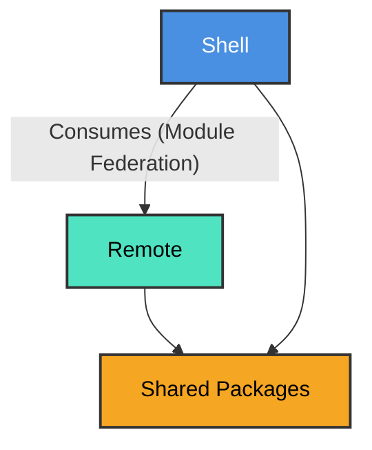
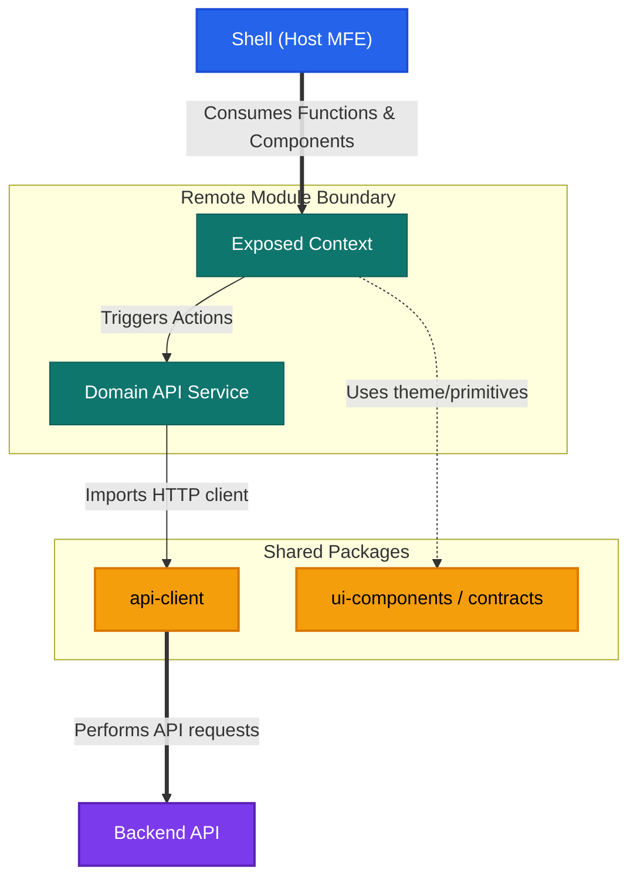

# Current System Architecture

## 1. Application Overview

The application is the **Seller Frontend Platform**. It is a comprehensive ecosystem designed to allow sellers to manage their operations. The application is built using a modern **Micro-Frontend (MFE)** architecture to enable independent development, deployment, and scalability of different business domains.

## 2. Architecture & Overall Structure

The architecture is based on **Vite** and **Module Federation** (`@module-federation/vite`). It divides the application into a central Host (Shell) and multiple Remote modules (MFEs), supported by a monorepo of shared libraries.

### Core Components:

| Component        | Type            | Description / Responsibilities                                                                                                         | Exposed Submodules / Services                |
| :--------------- | :-------------- | :------------------------------------------------------------------------------------------------------------------------------------- | :------------------------------------------- |
| seller           | Shell / Host    | The main entry point. It orchestrates the remote MFEs, handles global routing, injects minimal global context, and manages the layout. | None (Consumer)                              |
| seller-auth      | Remote          | Manages seller authentication flows (login, registration, etc.).                                                                       | ./Routes, Services                           |
| seller-account   | Remote          | Manages the seller's accounts.                                                                                                         | ./Routes, Services                           |
| seller-shared-ui | Shared Monorepo | A Turborepo-powered monorepo containing reusable packages.                                                                             | ui-components <br> api-client <br> contracts |

## 3. Module Relationships

The dependency flow enforces that the Shell consumes the Remotes, and both Shell and Remotes consume the Shared Libraries.



## 4. Domain Boundary Rules

Each Remote module represents an isolated **domain boundary**. The rules below define what must stay inside a remote, what must live in shared packages, and how modules may (or may not) communicate.

### 4.1 Boundary Overview



## 5. Provider Composition & Platform Contract

The Shell composes a single hierarchical provider tree that instantiates the host platform and establishes the authoritative session lifecycle.

### 5.1 Host Provider Hierarchy

```tsx
<ThemeProvider>
  <QueryClientProvider client={queryClient}>
    <BrowserRouter>
      <ShellPlatformProvider runtimeConfig={runtimeConfig}>
        <EntryLinkProvider runtimeConfig={runtimeConfig}>
          <AuthProvider onSessionCleared={() => queryClient.clear()}>
            {/* EventStreamProvider mounts SSE stream */}
            <ShellRoutes />
          </AuthProvider>
        </EntryLinkProvider>
      </ShellPlatformProvider>
    </BrowserRouter>
  </QueryClientProvider>
</ThemeProvider>
```

### 5.2 Single Platform Contract Invariants

1. **One Authoritative Platform:**
   `ShellPlatformProvider` constructs the late-bound session facade, `PlatformApiClient`, and `PlatformEvents` bus, packaging them into a frozen `SellerPlatform` that is passed directly to `PlatformProvider`.
2. **Session Bridge:**
   `AuthProvider` implements the session operations (`loadSession`, `refresh`, `expire`, `logout`) and binds them to the platform session bridge during `useLayoutEffect` before child effects execute.
3. **No Dual Session State:**
   Neither the Shell nor any Remote maintains independent `useState` session storage. Components subscribe reactively using `useSessionSnapshot()` from `@khinemyaezin/seller-ui`, backed by `useSyncExternalStore`.
4. **Remote Consumption:**
   Remotes receive `platform` as a prop on exposed UI entrypoints (e.g. `<AuthRoutes platform={platform} />`). Remotes may wrap their subtree in `<PlatformProvider platform={platform}>` so nested components can access `usePlatform()` or `useRequiredPlatform()`. Remotes must never create their own session.
5. **Multi-Merchant Tenancy Isolation:**
   When an access context switch occurs (`auth:context-selected:v1`), the shell invokes `queryClient.clear()` and `events.clear()` to purge domain caches before loading the new access context.
