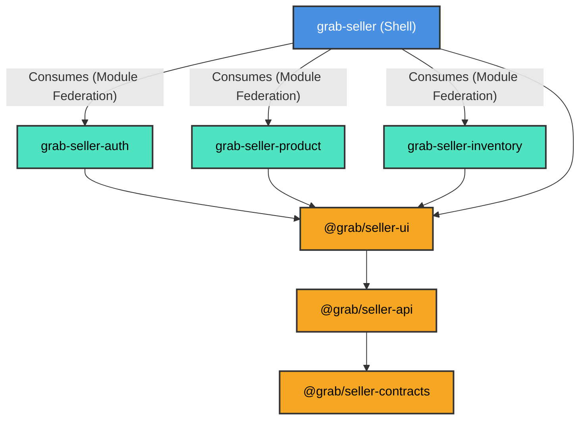

# Current System Architecture

## 1. Application Overview
The `grab-web` application is the **Seller Frontend Platform** for Grab. It is a comprehensive ecosystem designed to allow sellers to manage their operations, including authentication, product catalog management, and inventory tracking. The application is built using a modern **Micro-Frontend (MFE)** architecture to enable independent development, deployment, and scalability of different business domains.

## 2. Architecture & Overall Structure
The architecture is based on **Vite** and **Module Federation** (`@module-federation/vite`). It divides the application into a central Host (Shell) and multiple Remote modules (MFEs), supported by a monorepo of shared libraries.

### Core Components:
- **`grab-seller` (Shell/Host):** The main entry point. It orchestrates the remote MFEs, handles global routing, injects minimal global context (like Theme, Locale, User Identity), and manages the layout.
- **`grab-seller-auth` (Remote):** Manages seller authentication flows (login, registration, etc.). Exposes `Routes` and `AuthService`.
- **`grab-seller-product` (Remote):** Manages the seller's product catalog. Exposes `Routes`.
- **`grab-seller-inventory` (Remote):** Manages the seller's inventory and stock levels. Exposes `Routes`.
- **`grab-seller-shared-ui` (Shared Monorepo):** A Turborepo-powered monorepo containing reusable packages:
  - `@grab/seller-ui`: Shared React components (built with Radix UI and Tailwind CSS).
  - `@grab/seller-api`: Shared API client layer for data fetching.
  - `@grab/seller-contracts`: Centralized TypeScript definitions and API contracts.

## 3. Module Relationships
The dependency flow enforces that the Shell consumes the Remotes, and both Shell and Remotes consume the Shared Libraries.

