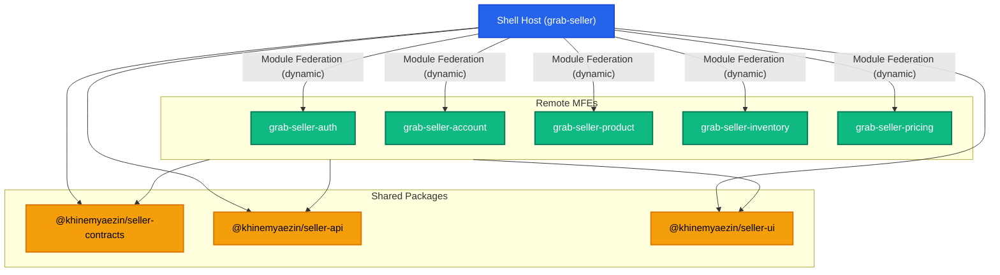

# Current System Architecture

## 1. Application Overview

The application is the **Seller Frontend Platform**. It is a comprehensive ecosystem designed to allow sellers to manage their operations. The application is built using a modern **Micro-Frontend (MFE)** architecture to enable independent development, deployment, and scalability of different business domains.

## 2. Architecture & Overall Structure

The architecture is based on **Vite** and **Module Federation** (`@module-federation/vite`). It divides the application into a central Host (Shell) and multiple Remote modules (MFEs), supported by a monorepo of shared libraries and tooling.

### Core Applications:

| Application                 | Type                   | Responsibilities                                                                                                         | Exposed Modules                                                                                                   |
| :-------------------------- | :--------------------- | :----------------------------------------------------------------------------------------------------------------------- | :---------------------------------------------------------------------------------------------------------------- |
| **`grab-seller`**           | Shell Host (Port 3000) | Root router, layout orchestration, authoritative session owner, host event bus, SSE stream provider, and runtime config. | None (Consumer)                                                                                                   |
| **`grab-seller-product`**   | Remote MFE (Port 3001) | Product catalog, sellable items, variants, media staging, and publication workflows.                                     | `./Routes`                                                                                                        |
| **`grab-seller-inventory`** | Remote MFE (Port 3002) | Locations, bins, zones, stock balances, replenishment, and inventory slots/widgets.                                      | `./DashboardRoutes`, `./LocationRoutes`, `./StockRoutes`, `./ProductInventoryWidget`, `./InventoryItemEditWidget` |
| **`grab-seller-auth`**      | Remote MFE (Port 3003) | Authentication UI (login, register), multi-merchant access context picker, and user menu widget.                         | `./Routes`, `./UserMenuWidget`                                                                                    |
| **`grab-seller-account`**   | Remote MFE (Port 3004) | Merchant onboarding (C2C & retailer flows), store profile, and storefront management.                                    | `./Routes`, `./StorefrontRoutes`                                                                                  |
| **`grab-seller-pricing`**   | Remote MFE (Port 3005) | Price lists, tier rules, and inline pricing creation/editing widgets for product forms.                                  | `./Routes`, `./PricingCreateWidget`, `./PricingEditWidget`                                                        |

### Shared Packages:

| Package                              | Scope                 | Description                                                                                                                                 |
| :----------------------------------- | :-------------------- | :------------------------------------------------------------------------------------------------------------------------------------------ |
| **`@khinemyaezin/seller-contracts`** | Types & Schemas       | Shared TypeScript interfaces, Zod schemas, HATEOAS links, event topic definitions, and breadcrumb contracts.                                |
| **`@khinemyaezin/seller-api`**       | Transport & Clients   | Cookie-credentialed API client with 401 refresh mutex, HATEOAS link expansion, backend event stream (SSE), and standalone platform factory. |
| **`@khinemyaezin/seller-ui`**        | Design System & Slots | Design system primitives, context bar, extension slot registry, reactive session hooks (`useSessionSnapshot`), and query state wrappers.    |

---

## 3. Module Relationships

The dependency flow enforces that the Shell consumes the Remotes dynamically via Module Federation, and both Shell and Remotes consume the Shared Libraries. Remotes never import directly from each other at build time or runtime.



---

## 4. Domain Boundary Rules

Each Remote module represents an isolated **domain boundary**.

### 4.1 Boundary Invariants

1. **No Remote Implementation Imports:**
   The shell host never imports remote source code or non-declared entrypoints directly. Only declared dynamic route and widget modules are consumed via Module Federation (`check:boundaries` rule 1).
2. **No Cross-Remote Imports:**
   Remote modules must never import files or types from other remotes. Inter-MFE communication happens exclusively through `platform.events` signal topics or extension slots (`check:boundaries` rule 3).
3. **Shared Package Purity:**
   Shared packages (`@khinemyaezin/*`) must never import from application code (`apps/*`).
4. **HATEOAS Discovery:**
   Navigation between business resources uses hypermedia relations (`followLink`, `readLink`) rather than hardcoded URLs.
5. **Cookie-Credentialed Transport:**
   Authentication tokens are managed as `HttpOnly` cookies. No raw bearer tokens are accessed by JavaScript.

---

## 5. Provider Composition & Platform Contract

The Shell composes a single hierarchical provider tree that instantiates the host platform and establishes the authoritative session lifecycle.

### 5.1 Host Provider Hierarchy

```tsx
<ThemeProvider>
  <QueryClientProvider client={queryClient}>
    <BrowserRouter>
      <ShellPlatformProvider runtimeConfig={runtimeConfig}>
        <EntryLinkProvider runtimeConfig={runtimeConfig}>
          <AuthProvider onSessionCleared={() => queryClient.clear()}>
            {/* EventStreamProvider mounts SSE stream during authenticated session */}
            <ShellRoutes />
          </AuthProvider>
        </EntryLinkProvider>
      </ShellPlatformProvider>
    </BrowserRouter>
  </QueryClientProvider>
</ThemeProvider>
```

### 5.2 Single Platform Contract Invariants

1. **One Authoritative Platform:**
   `ShellPlatformProvider` constructs the late-bound session facade, `PlatformApiClient`, and `PlatformEvents` bus, packaging them into a frozen `SellerPlatform` passed directly to `PlatformProvider`.
2. **Session Bridge:**
   `AuthProvider` implements the session operations (`loadSession`, `refresh`, `expire`, `logout`) and binds them to the platform session bridge during `useLayoutEffect` before child effects execute.
3. **No Dual Session State:**
   Neither the Shell nor any Remote maintains independent `useState` session storage. Components subscribe reactively using `useSessionSnapshot()` from `@khinemyaezin/seller-ui`, backed by `useSyncExternalStore`.
4. **Remote Consumption:**
   Remotes receive `platform` as a prop on exposed UI entrypoints (e.g. `<AuthRoutes platform={platform} />`). Remotes may wrap their subtree in `<PlatformProvider platform={platform}>` so nested components can access `usePlatform()` or `useRequiredPlatform()`. Remotes must never create their own session.
5. **Multi-Merchant Tenancy Isolation:**
   When an access context switch occurs (`auth:context-selected:v1`), the shell invokes `queryClient.clear()` and `events.clear()` to purge domain caches before loading the new access context.
6. **Host-Owned SSE Connection:**
   The shell maintains a single authenticated Server-Sent Events stream (`GET /api/v1/events/stream`) via `fetch + ReadableStream`. Remotes consume backend notifications strictly by subscribing to domain signal topics on `platform.events`.
