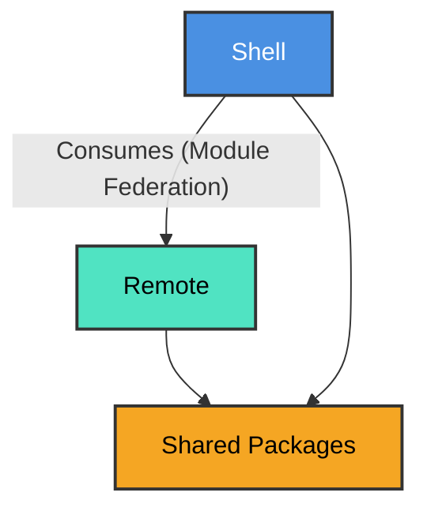
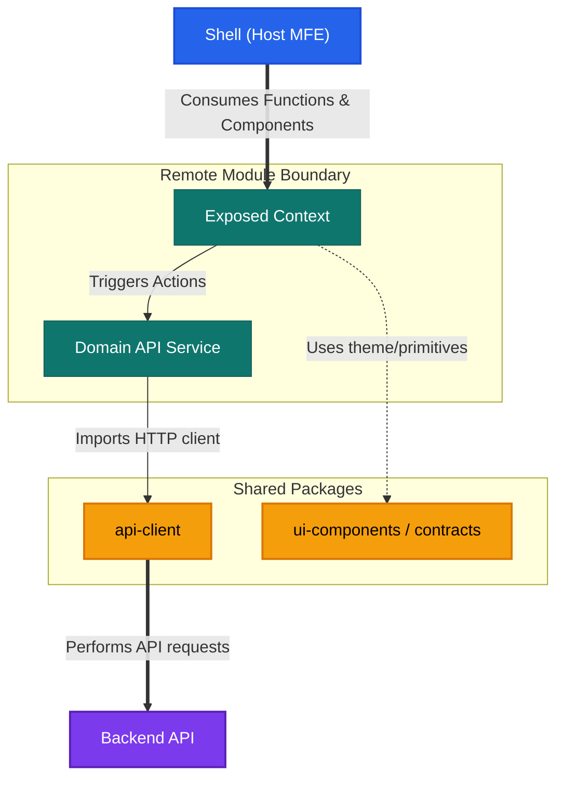

# Current System Architecture

## 1. Application Overview
The application is the **Seller Frontend Platform**. It is a comprehensive ecosystem designed to allow sellers to manage their operations. The application is built using a modern **Micro-Frontend (MFE)** architecture to enable independent development, deployment, and scalability of different business domains.

## 2. Architecture & Overall Structure
The architecture is based on **Vite** and **Module Federation** (`@module-federation/vite`). It divides the application into a central Host (Shell) and multiple Remote modules (MFEs), supported by a monorepo of shared libraries.

### Core Components:
| Component | Type | Description / Responsibilities | Exposed Submodules / Services |
| :--- | :--- | :--- | :--- |
| seller | Shell / Host | The main entry point. It orchestrates the remote MFEs, handles global routing, injects minimal global context, and manages the layout. | None (Consumer) |
| seller-auth | Remote | Manages seller authentication flows (login, registration, etc.). | ./Routes, Services |
| seller-account | Remote | Manages the seller's accounts. | ./Routes, Services |
| seller-shared-ui | Shared Monorepo | A Turborepo-powered monorepo containing reusable packages. | ui-components   api-client   contracts |

## 3. Module Relationships
The dependency flow enforces that the Shell consumes the Remotes, and both Shell and Remotes consume the Shared Libraries.

## 4. Domain Boundary Rules

Each Remote module represents an isolated **domain boundary**. The rules below define what must stay inside a remote, what must live in shared packages, and how modules may (or may not) communicate.

### 4.1 Boundary Overview

