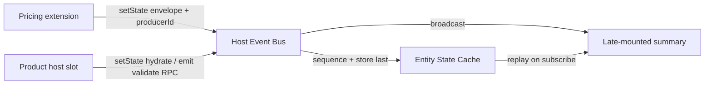
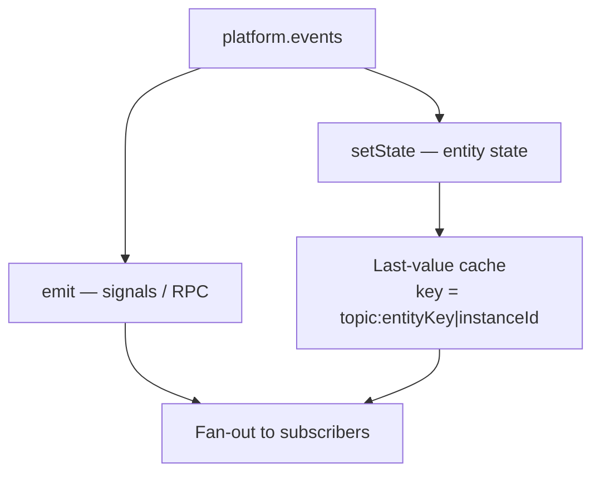

# Host-Mediated Session-Durable Event Bus

## Status

Accepted (implemented)

**Partially superseded by:** [ADR_006](./ADR_006-SlotBridgeCapabilityRegistry.md) — same-tree product form slots no longer use `setState` hydrate or `extension:validate:v1` / `extension:validated:v1` RPC. Bus mediation, last-value `setState` cache, envelopes / `producerId`, and remaining signals (`auth:*`, toast, breadcrumb, shell `form:*`, stream, workflow) remain.

**Supersedes (partially):** [ADR_001](./ADR_001-StateSharing&Communication.md) — specifically the assumption that cross-MFE messaging is *ephemeral peer pub/sub* only (fire-and-forget `CustomEvent` with no mediation, sequencing, or last-value replay). ADR_001’s decisions that remain in force: no shared global Redux/Zustand store, versioned contracts, decentralized domain state ownership, and framework-agnostic messaging.

**Does not supersede:** Backend outbox / module-scoped durability (`grab` repo: `docs/system/ADR_002-Module_scoped_outbox_architecture.md`). The browser bus coordinates UI extensions for a page session only; REST/HATEOAS remains the source of truth for business data.

**Related:** [ADR_002](./ADR_002-AuthStateSharingForMFEs.md) — `SellerPlatform` remains the single integration surface; auth/toast stay **signal** topics on `platform.events`. [ADR_006](./ADR_006-SlotBridgeCapabilityRegistry.md) — same-tree slot binding.

---

## 1. The Problem

**What's not working?**  
Cross-MFE messaging today is a thin singleton over `window` `CustomEvent`: publish fans out immediately, and a subscriber that mounts *after* a hydrate or domain update never sees that value. Extension slots (pricing today; inventory later) therefore race on mount order. There is also no `producerId`, so reflected events can echo back into the producer and recurse.

**What's at stake?**  
Without host mediation and a session last-value cache, late-mounted consumers (summaries, secondary extensions, remounted widgets) miss context or require brittle re-publish races. Peer broadcast also encourages remotes to import the shared singleton directly instead of the host-owned `platform.events` surface.

---

## 2. What We Decided

**The core approach:**  
The **host constructs and owns** a mediated event bus and freezes it onto `SellerPlatform.events`. Remotes publish and subscribe only through `platform.events` (temporary `eventBus` fallback allowed for standalone remote demos). The bus is **page-session durable**: in-memory last-value cache + monotonic sequencing per topic (and entity key when present). Not Kafka, not a backend outbox, not a global app store.

**Key changes:**

- **Host mediation:** `emit` (signals/RPC) vs `setState` (entity state). Only `setState` assigns `sequence`, updates last-value cache, and supports replay on `subscribe`.
- **Envelopes:** Domain and extension messages carry `producerId`, optional `entityKey` / `instanceId` / `slotId`, host-assigned `sequence`, and a typed payload.
- **Loop prevention:** Subscribers ignore events where `event.producerId === self.producerId`.
- **No topic durability classifier:** Call sites choose `emit` vs `setState`; TypeScript unions (`SignalEventPayloads` / `StateEventPayloads`) enforce which topics belong where. The bus never runs `isDurableEventTopic`.
- **Explicit pull + teardown:** `getSnapshot(type, key)` for mount-time hydrate; `clear(scope?)` on route / product-form unmount so cache entries do not leak across navigations.
- **Validation rule:** Only the primary editor runs validate RPC; consumers take sanitized post-validation / post-change payloads. `extension:validate:v1` / `extension:validated:v1` use `emit` (request/response, not last-value state).

**What stays the same:**

- Versioned topic names (`domain:action:vN`).
- No shared Redux/Zustand across MFEs.
- Backend remains authoritative for business data.
- Inventory may remain props-driven until a later phase; the bus is shaped so `extension:inventory:updated:v1` can follow the same path.

---

## 2.1. Visual Overview

### High-level mediation



### emit vs setState



---

## 2.2. Contract Definitions

Canonical types live in `@khinemyaezin/seller-contracts` (`events` + `PlatformEvents` on `SellerPlatform`).

### Envelope

```typescript
/** Host / producer metadata on mediated messages. */
type EventBusMeta = {
  /** Extension instance id, or `"host"` for shell / slot publishes. */
  producerId?: string;
  /** Entity correlation (sku, variantId, …). Part of cache key when set. */
  entityKey?: string;
  /** Monotonic sequence assigned by the host bus. */
  sequence?: number;
};

/** Slot RPC / legacy flat extension messages (hydrate, change, validate, …). */
type ExtensionEnvelope = EventBusMeta & {
  instanceId: string;
  slotId: string;
};

/** Domain update envelope (nested payload) for entity-keyed durable topics. */
type EventEnvelope<TPayload> = {
  producerId: string;
  entityKey?: string;
  sequence?: number;
  slotId?: string;
  instanceId?: string;
  payload: TPayload;
};
```

`producerId` is required on new domain update topics (e.g. `extension:pricing:updated:v1`). On existing flat extension topics it is additive/optional during migration; producers should set it (`instanceId` or `` `${slotId}:${instanceId}` ``) and consumers must ignore own echoes.

### emit vs setState (no topic allowlist)

| API | Topics (examples) | Cache + replay |
|------|-------------------|----------------|
| `setState` | `extension:hydrate:v1`, `extension:change:v1`, `extension:pricing:updated:v1` | Yes — key `` `${topic}:${entityKey ?? instanceId}` `` |
| `emit` | `auth:*`, `shell:toast:v1`, `extension:validate:v1`, `extension:validated:v1` | No |

Typed as `StateEventPayloads` / `SignalEventPayloads`. Durability is chosen at the call site, not by sniffing topic strings at runtime.

### `PlatformEvents`

```typescript
type EventSubscribeOptions = {
  /** Replay any cached setState snapshots for this topic. Default: true. */
  replay?: boolean;
};

type EventClearScope =
  | { topic: keyof StateEventPayloads; key?: string }
  | { instanceId: string }
  | { entityKey: string };

interface PlatformEvents {
  emit<K extends keyof SignalEventPayloads>(type: K, payload: SignalEventPayloads[K]): void;
  setState<K extends keyof StateEventPayloads>(type: K, payload: StateEventPayloads[K]): void;
  /** @deprecated Prefer emit / setState. Treated as emit (no cache). */
  publish<K extends keyof EventPayloads>(type: K, payload: EventPayloads[K]): void;
  subscribe<K extends keyof EventPayloads>(
    type: K,
    handler: (payload: EventPayloads[K]) => void,
    opts?: EventSubscribeOptions,
  ): () => void;
  getSnapshot<K extends keyof StateEventPayloads>(
    type: K,
    key: string,
  ): StateEventPayloads[K] | undefined;
  clear(scope?: EventClearScope): void;
}
```

Transport under the host API may still use `window` `CustomEvent`; mediation (sequence, cache, replay, clear) lives in the **host-owned** object on `SellerPlatform`, not in peer dispatch assumptions.

---

## 3. Why This Approach

1. **Late mounts work:** Hydrate and pricing updates survive delayed extension mounts via replay / `getSnapshot`.
2. **Decoupling preserved:** Consumers subscribe to versioned topics by `entityKey`; they never import peer MFE modules.
3. **No distributed monolith:** Last-value cache is not a global store — only session UI coordination.
4. **Aligns with `SellerPlatform`:** One USB-port surface (`platform.events`) instead of competing singletons.
5. **Clear durability boundary:** Page-session FE bus ≠ backend outbox; each layer keeps the right failure domain.

---

## 4. Trade-offs

| Pros | Cons |
|------|------|
| Fixes mount-order races without a second publish handshake | Cache must be cleared on teardown or keys leak across routes |
| Typed envelopes + emit/setState prevent accidental auth/toast caching | Producers must set `producerId` and filter echoes |
| Remotes stay framework-agnostic via `platform.events` | Temporary singleton fallback can hide missing host injection in demos |
| Additive contracts (`pricing:updated:v1`, optional meta on legacy topics) | Brief dual-publish period if `extension:change:v1` is kept for compat |

---

## 5. What Needs to Change

**Contracts (this ADR):**

- Extend `seller-contracts` envelopes and `PlatformEvents` (`emit`, `setState`, `getSnapshot`, subscribe `replay`, `clear`, `StateEventPayloads` / `SignalEventPayloads`, `extension:pricing:updated:v1`).

**Host / runtime (follow-on):**

- Implement `createHostEventBus()` in `seller-api`; construct once in shell `AuthProvider` and freeze onto `SellerPlatform`.
- Call `events.clear` from product extension lifecycle (slot provider / form unmount).

**Reference path (follow-on):**

- Product pricing slot publishes hydrate with `producerId: "host"` + `entityKey`.
- Pricing widget: snapshot or subscribe-with-replay on mount; publish `extension:pricing:updated:v1`; ignore own `producerId`.
- Thin late-mount consumer fixture to prove replay.

**Guardrails:**

- Remotes never import peer modules; only `platform` + contracts.
- Unit tests: sequence order, producerId loop drop, late subscribe replay, `clear` isolation.

---

## 6. Related Documents

- [ADR_001 — MFE State Sharing and Communication](./ADR_001-StateSharing&Communication.md) (partially superseded)
- [ADR_002 — Auth State Sharing for MFEs](./ADR_002-AuthStateSharingForMFEs.md)
- [ADR_006 — Slot Bridge and Capability Registry](./ADR_006-SlotBridgeCapabilityRegistry.md) (partially supersedes this ADR for same-tree slot hydrate / validate RPC)
- Backend ADR_002 — Module-scoped outbox (`grab` repo: `docs/system/ADR_002-Module_scoped_outbox_architecture.md`) — separate durability domain
- `@khinemyaezin/seller-contracts` — `events/index.ts`, `auth.ts` (`PlatformEvents`)

---

## 7. Alternative Methods Considered & Rejected

**Rejected: Keep ephemeral peer `CustomEvent` only**  
- *Does not* solve late mounts or producer echo loops without ad-hoc re-publish races.

**Rejected: Shared global store (Redux / Zustand) across MFEs**  
- Already rejected by ADR_001; recreates a distributed monolith and version-locks UI state libraries.

**Rejected: Backend outbox → browser push / SSE for extension UI**  
- Wrong durability domain for form-slot hydrate and pricing draft sync; backend remains source of truth via REST when persistence is required.

**Rejected: Inventory migration in this promotion**  
- Bus API is designed for a future `extension:inventory:updated:v1`; inventory stays props-driven until a dedicated phase.
