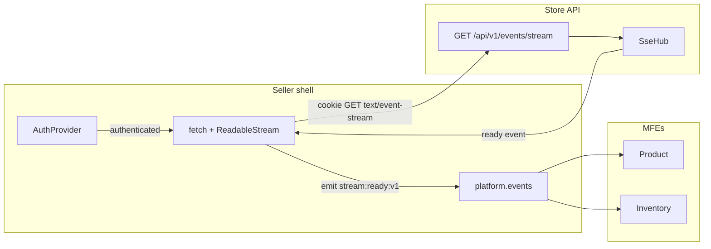
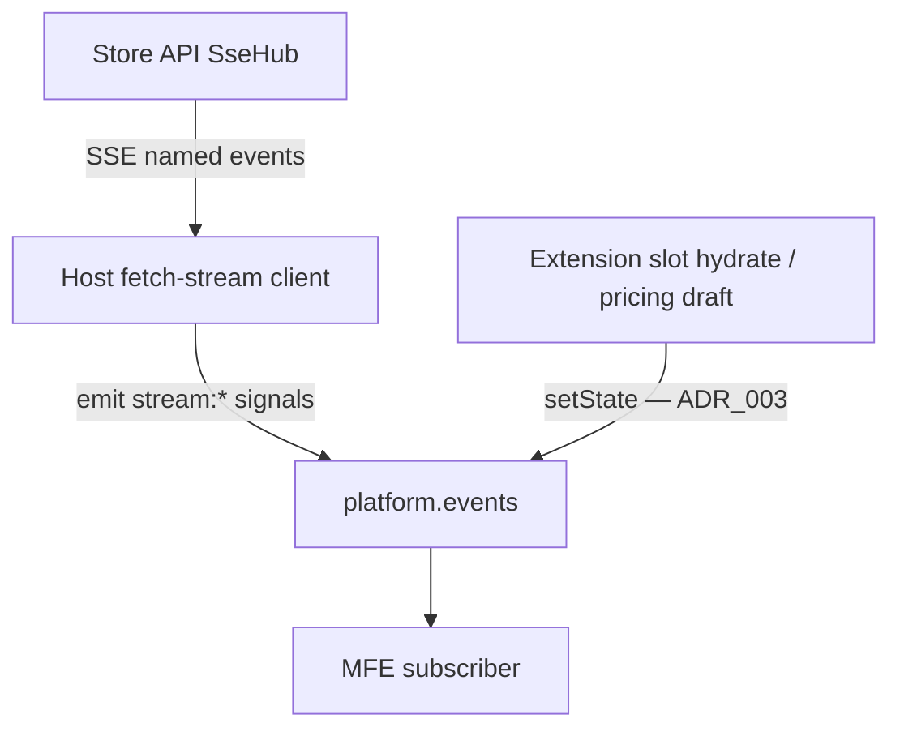

# Host-Owned Backend Event Stream

## Status

Accepted (implemented; domain mapping is ADR_005)

**Does not supersede:** [ADR_003](./ADR_003-HostMediatedSessionDurableEventBus.md). ADR_003 still owns the **in-page** bus (`platform.events`, last-value cache). Same-tree slot hydrate/validate is [ADR_006](./ADR_006-SlotBridgeCapabilityRegistry.md). This ADR adds a complementary **backend → browser** transport. SSE is still the wrong tool for extension-slot UI sync.

**Does not supersede:** [ADR_002](./ADR_002-AuthStateSharingForMFEs.md). `SellerPlatform` remains the single integration surface. Credentials stay in `HttpOnly` cookies. The 401 refresh mutex in the HAL client remains the session refresh path.

**Related (backend):** `grab` ADR_008 — Seller UI event stream (`docs/system/ADR_008-Seller_ui_event_stream.md`). One `SseHub`, cookie-authenticated `GET /api/v1/events/stream`, Spring MVC `SseEmitter`.

---

## 1. The Problem

**What's not working?**  
The seller shell has no authenticated long-lived channel from the store API. MFEs can only learn that a backend workflow finished by polling REST. Native `EventSource` cannot participate in the existing 401 refresh mutex in `seller-api` (`client.ts`), so a naive SSE client would either fail after cookie expiry or rotate cookies outside the host coordinator.

**What's at stake?**  
If remotes open their own streams, we multiply cookie-authenticated connections, leak transport into MFE code, and bypass host session ownership. If we reuse SSE for extension-slot hydrate (the case ADR_003 already rejected), we mix page-session UI coordination with backend push.

---

## 2. What We Decided

**The core approach:**  
The **host owns the socket**. One `fetch` + `ReadableStream` connection (credentials included) is opened from the seller shell when the session is authenticated. Parsed SSE frames that matter are mapped onto **signal** topics on `platform.events`. Remotes never import an SSE client; they already subscribe through `platform.events`.

**Key changes:**

- **Do not use native `EventSource`.** Use `fetch` + `ReadableStream` with `credentials: "include"`, `Accept: text/event-stream`, and the same `platform.session.refresh()` retry as the HAL client.
- **`seller-api`:** `createBackendEventStream()` — parse SSE frames (`id` / `event` / `data` / comments), abort via `AbortController`, exponential backoff reconnect, pass `Last-Event-ID` on retry (plumbing only; no server replay yet).
- **`seller-contracts`:** add signal topics only:
  - `stream:ready:v1`
  - `stream:disconnected:v1`
- **Host hook** (e.g. `useBackendEventStream`) from `AuthProvider`:
  - start when `snapshot.status === "authenticated"`
  - abort on logout / anonymous / unmount
  - reconnect after `auth:context-selected:v1` so later scoped publish matches the new access context
  - map SSE named event `ready` → `platform.events.emit("stream:ready:v1", …)`
- **Discovery:** use API root HAL `event-stream` when present; fallback `/events/stream` relative to `apiBaseUrl`.
- **Proxies:** Vite `/api` proxy `timeout: 0` and `proxyTimeout: 0`. Nginx dedicated `location /api/v1/events/stream` **before** `location /api/` with buffering off, cache off, long `proxy_read_timeout`, and `Connection ""`. Standalone MFE nginx files that proxy `/api/` get the same location so local remote demos do not buffer the stream.

**What stays the same:**

- Remotes stay unaware of SSE. They subscribe to versioned `platform.events` topics.
- Auth/toast remain **signal** topics (`emit`, no last-value cache), as in ADR_002 / ADR_003.
- REST/HATEOAS remains the source of truth for business data. A stream signal may trigger refetch; it does not replace HAL.
- Heartbeat SSE **comments** (`: ping`) are keep-alives only. They are not mapped onto `platform.events`.
- Backend outbox durability is unchanged (`grab` ADR_002). This client does not consume the outbox.

### Boundary

| Owns | Does not own |
|------|----------------|
| One authenticated long-lived connection from the shell | Domain event mapping (workflow status, inventory, merchant) |
| Frame parse, abort, reconnect, `Last-Event-ID` header plumbing | Server-side replay / inbox |
| Host-to-bus mapping for **stream lifecycle** signals | Per-MFE EventSource / fetch-stream |
| Proxy settings so the stream is not idle-cut | In-page extension-slot sync (ADR_003) |

---

## 2.1. Visual Overview

### Host owns the socket; remotes see the bus



### Complementary to ADR_003



ADR_003 rejected SSE **for slot UI sync**. This ADR uses SSE **only** as the backend → host pipe. The bus remains the USB port.

---

## 2.2. Contract Definitions

Canonical types live in `@khinemyaezin/seller-contracts`. Stream topics are **signals** (`emit`), not `setState`.

```typescript
type StreamReadyV1 = {
  producerId: "backend" | "host";
  /** SSE event id when the server sent one. */
  lastEventId?: string;
};

type StreamDisconnectedV1 = {
  producerId: "host";
  reason?: "abort" | "error" | "logout" | "context-change";
};
```

| Topic | API | Who emits | Who consumes |
|-------|-----|-----------|----------------|
| `stream:ready:v1` | `emit` | Host, after SSE `ready` | Optional; MFEs that need “backend push is up” |
| `stream:disconnected:v1` | `emit` | Host, on abort / error / logout | Optional; do not treat as domain failure |

Heartbeat comments are dropped in the parser. Domain envelopes (workflow completed, inventory changed, …) are **not** in this ADR; a later adapter will add versioned signal or state topics and the host will map named SSE events onto them.

`createBackendEventStream()` is a `seller-api` runtime helper, not part of `SellerPlatform`. Remotes must not call it.

---

## 3. Why This Approach

1. **Host session ownership:** The stream starts and stops with `SessionSnapshot`, same as the rest of cookie-auth UI (ADR_002).
2. **Refresh mutex:** `fetch` can retry through `platform.session.refresh()`; `EventSource` cannot.
3. **One USB port:** Remotes keep a single integration surface. Transport stays an implementation detail of the shell.
4. **Complementary, not competing, with ADR_003:** In-page last-value cache still solves mount-order races. Backend push still solves “the server finished after the POST returned.”
5. **Discovery over hard-coded paths:** HAL `event-stream` matches how the rest of the seller API is consumed; fallback keeps local demos working before the link exists.
6. **Proxy honesty:** Without buffering off and infinite proxy timeouts, the hub is correct and the browser still sees a dead connection.

---

## 4. Trade-offs

| Pros | Cons |
|------|------|
| One connection shared by all remotes | Host must stay mounted; standalone remotes without the shell have no stream |
| `fetch` + refresh mutex matches HAL client | Custom SSE parser instead of `EventSource` |
| Lifecycle topics are signals — no accidental last-value cache | MFEs that miss `stream:ready:v1` must not require it for correctness |
| `Last-Event-ID` plumbing is ready for later replay | No replay yet; gaps require REST refetch |
| Dedicated nginx location is explicit | Every `/api/` proxy (host + standalone remotes) must copy the location |
| Heartbeats stay off the bus | Parser must ignore comments so `: ping` never becomes a fake domain event |

---

## 5. What Needs to Change

**Contracts (this ADR):**

- Add `stream:ready:v1` and `stream:disconnected:v1` to `SignalEventPayloads` in `seller-contracts`.

**Host / `seller-api` (follow-on implementation):**

- `createBackendEventStream()` — parse, abort, backoff reconnect, `Last-Event-ID`.
- `useBackendEventStream` (or equivalent) wired from `AuthProvider`.
- Discover `event-stream` from API root; fallback `/events/stream`.

**Proxies (required or the stream dies):**

- `grab-seller/vite.config.ts` — `/api` `timeout: 0`, `proxyTimeout: 0`.
- `grab-seller/gateway/nginx.conf` — dedicated `/api/v1/events/stream` location before `/api/`.
- Standalone MFE nginx files that proxy `/api/` (product / inventory / auth / account / pricing) — same location.

**Guardrails:**

- Remotes never open SSE and never import `createBackendEventStream`.
- Heartbeat comments are not emitted on `platform.events`.
- Do not use this stream for extension-slot hydrate or pricing draft sync (ADR_003).

**Explicitly not this slice:**

- Mapping workflow `COMPLETED` / `FAILED` / `COMPENSATED` — see ADR_005.

---

## 6. Related Documents

- [ADR_001 — MFE State Sharing and Communication](./ADR_001-StateSharing&Communication.md)
- [ADR_002 — Auth State Sharing for MFEs](./ADR_002-AuthStateSharingForMFEs.md) — session snapshot, refresh mutex, cookie credentials
- [ADR_003 — Host-Mediated Session-Durable Event Bus](./ADR_003-HostMediatedSessionDurableEventBus.md) — in-page bus; not superseded
- Backend ADR_008 — Seller UI event stream (`grab` repo: `docs/system/ADR_008-Seller_ui_event_stream.md`)
- Backend ADR_009 — Workflow terminal UI notifications (`grab` repo: `docs/system/ADR_009-Workflow_terminal_ui_notifications.md`)
- [ADR_005 — Workflow terminal signals](./ADR_005-WorkflowTerminalSignals.md)
- `@khinemyaezin/seller-contracts` — `SignalEventPayloads`
- `@khinemyaezin/seller-api` — HAL `client.ts` refresh path; `readBackendEventStream()`

---

## 7. Alternative Methods Considered & Rejected

**Rejected: Native `EventSource`**  
Cannot send custom headers beyond `Last-Event-ID`, cannot share the HAL 401 refresh mutex, and reconnects on its own schedule without abort-on-logout.

**Rejected: Per-MFE connections**  
Duplicates sockets, leaks transport into remotes, and fights host session ownership.

**Rejected: WebSockets from the shell**  
Bidirectional protocol is unused; SSE matches the backend `SseEmitter` choice (grab ADR_008).

**Rejected: Mapping heartbeats onto `platform.events`**  
Keep-alives would wake every MFE subscriber every 15s. Comments stay in the parser.

**Rejected: Using SSE for extension-slot UI sync**  
Already rejected by ADR_003. Slot hydrate and pricing drafts stay on the host-mediated in-page bus.

**Rejected: Superseding ADR_003 with this stream**  
The two paths have different failure domains: page-session last-value cache vs best-effort backend push. REST remains authoritative for business data.
