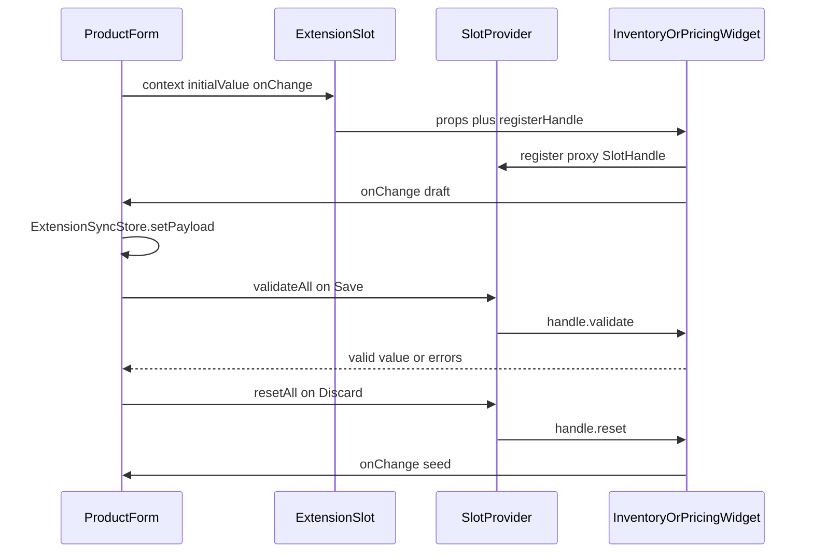

# Slot Bridge and Capability Registry

## Status

Accepted (implemented)

**Partially supersedes:** [ADR_003](./ADR_003-HostMediatedSessionDurableEventBus.md) — specifically same-tree product form slot **hydrate** (`setState` on `extension:{pricing|inventory}:{new|edit}:{hydrate|updated}:v1`) and **validate RPC** (`extension:validate:v1` / `extension:validated:v1`). ADR_003 remains in force for host mediation, last-value `setState` cache, envelopes / `producerId`, and remaining signals.

**Does not supersede:** [ADR_001](./ADR_001-StateSharing&Communication.md) (no shared global store, versioned contracts, decentralized domain ownership), [ADR_002](./ADR_002-AuthStateSharingForMFEs.md) (`SellerPlatform` as the USB-port surface; auth/toast stay signals), [ADR_004](./ADR_004-HostOwnedBackendEventStream.md) (host-owned SSE), [ADR_005](./ADR_005-WorkflowTerminalSignals.md) (workflow terminal mapping).

**Restores:** ADR_001’s “do not overuse the Event Bus” for same-DOM form composition. Host and remotes already share one React tree via `ExtensionSlot`; pub/sub is the wrong tool for that binding.

---

## 1. The Problem

**What's not working?**  
Same-tree inventory and pricing widgets used `platform.events` as a two-way form binding: the host `setState`d hydrate, remotes `setState`d drafts, and Save ran `extension:validate:v1` ping-pong with a 3s fail-closed timer. Drafts lived in both the bus last-value cache and `ExtensionSyncStore`. A second `validate()` while one was in flight returned `[]`, which submit treated as success.

**What's at stake?**  
Save could pass with empty results, SKU keystrokes stormed hydrate topics, tests needed a bus mock, and a missed `clear`/`prune` leaked cache entries. The bus was solving a React composition problem.

---

## 2. What We Decided

**The core approach:**  
Same-DOM product form slots use a **Slot Bridge**: context and drafts travel as React props; `validate()` / `getValues()` are **direct `SlotHandle` calls** on the existing `SlotProvider` registry. `createHostEventBus` stays for **true signals** (auth, toast, breadcrumb, shell `form:*`, workflow/stream) — not form binding.

**Key changes:**

- **Props down:** host wrappers pass `{ groupId, context, initialValue, onChange }`. Live SKU / variant id is `context`, not a hydrate topic. Remotes seed local state from `initialValue` once; a new `groupId` remounts the row.
- **Callbacks up:** widget `onChange` writes the host `ExtensionSyncStore` (the only draft source of truth).
- **Capability registry:** `ExtensionSlot` injects `registerHandle`. Remotes register a **proxy handle immediately** in `useLayoutEffect` (no `ref.current` guard — the widget ref is set after paint). `register` still keys `${groupId}::${slotId}` and overwrites.
- **Save:** `useValidateAllSlots` is `Promise.all(list().map(handle.validate))`. Missing handle → fail-closed `{ valid: false }` immediately (no 3s timer). A concurrent `validate()` awaits the in-flight promise instead of returning `[]`.
- **Discard:** `useResetAllSlots` is `list().forEach(handle.reset)`. Widgets restore a captured seed and `onChange` it so `ExtensionSyncStore` matches. Missing `reset` is a no-op. Host `form.reset()` does not cover remote widget state.
- **Past-tense topic rule:** remaining bus topics are notifications of facts that already happened (or chrome commands already scoped out). Do not add new request/response topics for slot binding.
- **Dropped topics:** `extension:validate:v1`, `extension:validated:v1`, and the eight `extension:{pricing|inventory}:{new|edit}:{hydrate|updated}:v1` topics.

**What stays the same:**

- `SellerPlatform` / `platform.events` for auth, toast, breadcrumb, shell `form:save:v1` / `form:discard:v1` / `form:saved:v1` / `form:dirty:v1`, `stream:*`, `workflow:updated:v1`.
- Host `ExtensionSyncStore` + domain `registerDomain` / `prune` / `clearDomain` / `describe` + submit `validate()` then `runDomainSubmit(results)`.
- `SlotValidateResult` (`groupId`, `slotId`, `valid`, `value?`, `errors?`) as the submit shape. Widget handles stay `{ value?, errors? }`; remotes adapt to `{ valid, value?, errors? }`.
- Inventory-edit `validate` remains a no-op success (not part of this cutover). `EDIT_INVENTORY_INLINE` remains unregistered. Shell `form:save:v1` still has its chrome timeout.

### Event bus that remains

| Keep | Drop |
|------|------|
| `auth:*`, `shell:toast:v1`, `shell:breadcrumb:v1` | `extension:validate:v1`, `extension:validated:v1` |
| `form:dirty:v1`, `form:save:v1`, `form:discard:v1`, `form:saved:v1` | `extension:{pricing\|inventory}:{new\|edit}:hydrate:v1` (4) |
| `stream:*`, `workflow:updated:v1` | `extension:{pricing\|inventory}:{new\|edit}:updated:v1` (4) |

---

## 2.1. Visual Overview



---

## 2.2. Contract Definitions

Canonical types live in `@khinemyaezin/seller-contracts` (`extensions/slot-bridge.ts`, `ExtensionMountProps`).

```ts
export type SlotHandle<TValue = unknown, TErrors = ExtensionFieldErrors> = {
  validate: () => Promise<{ valid: boolean; value?: TValue; errors?: TErrors }>;
  getValues: () => TValue;
  reset?: () => void;
};

export type SlotWidgetHandle<TValue> = {
  validate: () => Promise<WidgetValidateResult<TValue>>;
  getValues: () => TValue;
  reset?: () => void;
};
```

`ExtensionMountProps` adds `initialValue?`, `onChange?`, and `registerHandle?`. Host wrappers do not pass `registerHandle` — `ExtensionSlot` injects it so a presence-only `register({ groupId, slotId })` cannot overwrite the handle.

---

## 3. Why This Approach

1. **`await handle.validate()` is deterministic.** Errors map to `groupId`. Unmount unregisters. No 3s timeout and no empty-array success.
2. **One draft source of truth.** Host `ExtensionSyncStore` holds uncommitted values; remotes are unit-testable without a bus mock.
3. **SKU/context updates are React props**, not a topic storm on every keystroke.
4. **Restores ADR_001.** The bus is for cross-MFE notifications, not same-tree form plumbing.
5. **Submit already went through `useValidateAllSlots`.** Putting handles on `SlotProvider` keeps one `Promise.all` path for every slot family.

---

## 4. Trade-offs

| Pros | Cons |
|------|------|
| Deterministic validate; fail-closed immediately if the remote has not registered | Host must thread `context` / `initialValue` / `onChange` |
| Host store is the only draft SoT; unmount unregisters | A forgotten `onChange` silently drops drafts (the bus used to deliver anyway) |
| Remotes are unit-testable; no producerId echo filters | Federated `Suspense` can mean no handle until the remote loads |
| Contracts, UI, host, and remotes cut over together (no dual-run) | Out-of-tree observers of uncommitted drafts would need a new past-tense signal (none exist today) |
| | iframe / non-React remotes would not work (not the architecture today) |

Keep the bus path only if you need late-mounted, out-of-tree observers of uncommitted slot drafts, or you cannot cut over contracts + remotes + host together. Neither applies here.

---

## 5. What Changed

**Contracts:** `SlotHandle`; `SlotWidgetHandle.reset`; `ExtensionMountProps` gains `initialValue` / `onChange` / `registerHandle`; hydrate / updated / validate topics removed from `SignalEventPayloads` / `StateEventPayloads`.

**seller-ui:** `RegisteredSlot.handle`; `ExtensionSlot` injects `registerHandle`; `useValidateAllSlots` calls handles and coalesces concurrent `validate()`; `useResetAllSlots` calls optional `handle.reset` on discard.

**Product host:** slot wrappers pass props; four sync hooks keep store + submit contract and drop `usePlatform` / hydrate `setState` / `updated` subscribe.

**Remotes:** inventory and pricing slot hooks register a proxy handle and `onChange` the merged draft. Widgets capture the first seed and restore it from `handle.reset`.

---

## 6. Related Documents

- [ADR_001 — MFE State Sharing and Communication](./ADR_001-StateSharing&Communication.md)
- [ADR_003 — Host-mediated session-durable event bus](./ADR_003-HostMediatedSessionDurableEventBus.md) (partially superseded)
- [ADR_004 — Host-owned backend event stream](./ADR_004-HostOwnedBackendEventStream.md)
- `@khinemyaezin/seller-contracts` — `extensions/slot-bridge.ts`, `extensions/types.ts`, `events/payload.ts`
- `@khinemyaezin/seller-ui` — `SlotProvider`, `ExtensionSlot`, `useValidateAllSlots`, `useResetAllSlots`

---

## 7. Alternative Methods Considered & Rejected

**Rejected: Keep bus hydrate + validate RPC**  
Fixes late mounts for out-of-tree observers, but we have none. Costs a 3s fail-closed timer, dual draft state, concurrent `validate()` returning `[]`, and hydrate `setState` on every SKU keystroke.

**Rejected: Per-domain `Map` inside `useInventorySlotBridge` (and siblings)**  
Submit already aggregates through `useValidateAllSlots`. A second registry would split `Promise.all` paths per family.

**Rejected: Dual-run (props + events) during migration**  
Full cutover of all four families in one change, then delete the topics. Dual-run would keep the timeout path and two sources of truth.

**Rejected: Host wrappers pass `registerHandle`**  
A presence-only `register({ groupId, slotId })` on `ExtensionSlot` would overwrite the remote’s handle if the effect re-ran.

**Out of scope:** shell `form:save:v1` / `form:discard:v1` (chrome command channel); missing `EDIT_INVENTORY_INLINE` registration; `AbortSignal` on `validate` (type can allow it later; widgets ignore it now).
