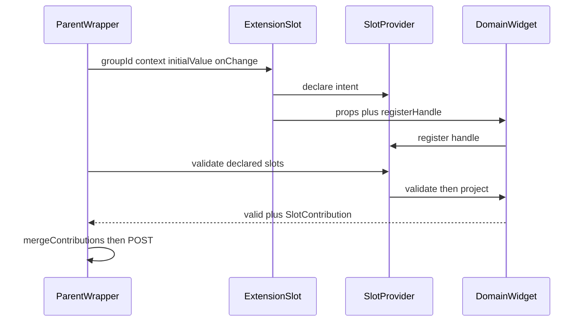

# Declaration-Driven Slot Contributions

## Status

Accepted (implemented)

**Partially supersedes:** [ADR_006](./ADR_006-SlotBridgeCapabilityRegistry.md) — specifically fail-open Save when a federated widget never registers a handle, and parent-owned projection (`DomainSubmitContract` / `runDomainSubmit` / per-domain adapters). ADR_006 remains in force for props-down / handle-up, `SlotProvider` as the capability registry, and the past-tense topic rule (no event bus for slot binding).

**Does not supersede:** [ADR_001](./ADR_001-StateSharing&Communication.md), [ADR_002](./ADR_002-AuthStateSharingForMFEs.md), [ADR_003](./ADR_003-HostMediatedSessionDurableEventBus.md) (remaining signals), [ADR_004](./ADR_004-HostOwnedBackendEventStream.md), [ADR_005](./ADR_005-WorkflowTerminalSignals.md).

---

## 1. The Problem

**What's not working?**  
`ExtensionSlot` returned `fallback` before rendering when a remote was missing, still suspending, or crashed. `registerHandle` never ran, `validate()` saw no slot, and Save proceeded without that domain's data. Projection of inventory ops and pricing amounts lived in the product parent, so a new inventory op required a product-module deploy.

**What's at stake?**  
A missing pricing or inventory remote silently dropped lines from the sellable-product request. Domain knowledge in the parent violated single responsibility and made onboarding a third slot family expensive.

---

## 2. What We Decided

**The core approach:**  
Same-tree slots are **declaration-driven**. `ExtensionSlot` registers a `SlotDeclaration` for the lifetime of the parent wrapper, independently of whether the federated widget mounted. Save iterates declarations, not handles. Each domain **projects itself** through `SlotHandle.project()`.

**Key changes:**

- **Declare intent, then reconcile.** Missing handle on a required declaration is `{ valid: false }` with a structured `_slot` error. `optional: true` skips that failure. `validate()` races a timeout (default 10s) so an unsettled promise cannot hang Save forever.
- **Domain-owned `project()`.** A valid handle may return `SlotContribution[]` (`{ slice, append }`). The parent calls `mergeContributions(results, PRODUCT_SLICES)` and never inspects payload internals. An unknown slice is a hard error.
- **Draft store is a cache.** `SlotProvider` holds drafts for `initialValue`, remount, and dirty tracking. `DomainSubmitContract` / `registerDomain` / `runDomainSubmit` are deleted. Prune runs in a provider-level delayed effect against declared `groupId`s so StrictMode and transient Suspense do not wipe drafts.
- **Errors stay keyed.** `SlotValidationErrors` uses `${groupId}::${slotId}`. `useSlotErrors(groupId)` lets wrappers render inline errors; toasts name the failing group.
- **Presentation is a variant, not a slot id.** `full` vs `inline` is `variant` on one slot name. Shell registry is one table of four widgets.

**What stays the same:**

- Props down (`groupId`, `context`, `initialValue`, `onChange`); handle up (`validate` / `getValues` / `reset`).
- Event bus for auth, toast, breadcrumb, shell `form:*`, stream, workflow — not slot binding.
- Parent-mediated communication only. Sibling slots do not subscribe to each other.

---

## 2.1. Visual Overview

---

## 3. Why This Approach

1. **Save can observe intent.** A declared slot with no handle is a failure, not silence.
2. **SRP.** Inventory owns `CREATE`/`ADJUST`; pricing owns `currencyCode`/`amount`. The parent owns placement and the slice allowlist.
3. **Minimum effort from the current Slot Bridge.** No event bus, no web-component boundary, no BFF saga.

---

## 4. Trade-offs

| Pros | Cons |
|------|------|
| Fail-closed on missing, crashing, or suspending remotes | Parent no longer re-validates remote payloads against JSON Schema |
| New domain op ships without a product deploy | Unknown-slice check is shape-only; backend remains the content authority |
| Onboarding a domain is widget + `project()` + one registry row + allowlist key | React-only; iframe / non-React remotes still out of scope |
| Timeout replaces unbounded `Promise.all` | Widgets must ignore or honor `AbortSignal` themselves |

The trust-boundary move is acceptable: remotes are first-party, same-origin, version-locked federation singletons. `ExtensionSlotContract.payloadSchema` remains available if generic schema validation is needed later.

---

## 5. Alternative Methods Considered & Rejected

**Rejected: Web Components boundary**  
Would admit non-React remotes, but widgets mount inside the parent's `FormProvider` and read `platform` / `entryLink` from React context.

**Rejected: BFF / per-domain PATCH after product create**  
Total frontend decoupling, but loses atomic "create product with price and stock" and needs saga compensation. Keep as an escape hatch if slices keep multiplying.

**Rejected: Form-aggregate child controllers (RHF nested field arrays / Angular CVA)**  
Validation and dirty would come free, but both sides couple to RHF internals and field names collide across remotes. `SlotHandle` stays the thinner port.

**Rejected: Sibling event channel**  
ADR_006 already forbids request/response topics for slot binding. Cross-slot needs stay parent-mediated via `context`.

---

## 6. Related Documents

- [ADR_006 — Slot Bridge and Capability Registry](./ADR_006-SlotBridgeCapabilityRegistry.md)
- `@khinemyaezin/seller-contracts` — `extensions/slot-bridge.ts`, `extensions/slots.ts` (generic runtime), `extensions/product-slots.ts` (product catalogs)
- `@khinemyaezin/seller-ui` — `SlotProvider`, `ExtensionSlot`, `useValidateAllSlots`, `mergeContributions`, `useSlotDraft`
